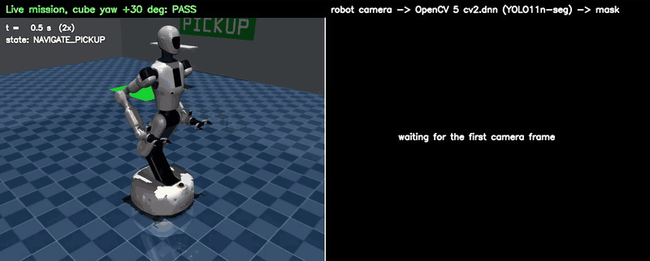
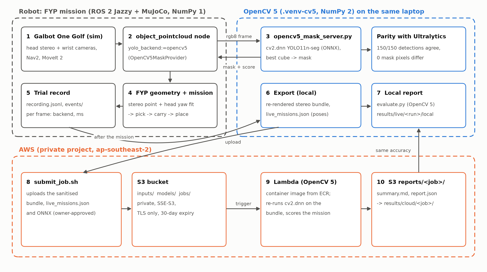

# Vision2Action: Cloud-Validated Robotic Manipulation

**From pixels to action: autonomous robotic manipulation powered by OpenCV 5, with reproducible perception evaluation on AWS.**

Vision2Action is a ROS 2-based robotic system that combines OpenCV 5-powered object
perception, autonomous mobile manipulation and AWS cloud evaluation.

Developed for the **OpenCV AI Competition 2026**, powered by AWS.

**Project status:** Validated in MuJoCo simulation. Physical robot deployment is planned for future work.

## 🎥 Demo

**[▶ Watch the demo video](docs/media/live_mission_opencv5.mp4)**

The demonstration shows a simulated Galbot robot performing an autonomous pick-and-place
task using live OpenCV 5 perception.



- **Left:** the robot's mission.
- **Right:** the camera frames the robot sent to OpenCV 5 during that mission, each with
  the segmentation mask `cv2.dnn` returned.

This mission placed the cube 3.6 mm from the target. All 252 frames found the cube, at
about 33 ms per forward pass. The GIF plays at 6x, and the video at 2x.

## Overview

Accurate object detection and localisation are important for autonomous robotic
manipulation. Even small perception errors can affect grasping performance.

Vision2Action explores how OpenCV 5 can support robot perception and how AWS can make
perception evaluation easier to reproduce.

The system combines two components:

**1. Autonomous Robotic Manipulation**

A simulated Galbot robot uses OpenCV 5 and YOLO11 segmentation to detect objects and
estimate their positions. These estimates guide autonomous pick-and-place operations.
OpenCV 5 runs inside the live mission. It is not only an offline benchmark.

**2. Cloud-Based Perception Evaluation**

Recorded evaluation data is processed locally and on AWS to measure perception accuracy
and check reproducibility.

### What this repository contains

- **Contents:** the OpenCV 5 perception pipeline, the evaluation framework, the AWS
  pipeline, the trained model, a validation set, and all measured results.
- **Not included:** the robot software (the Galbot ROS 2 workspace with the mission, Nav2,
  MoveIt 2 and worlds). It belongs to the author's final-year project and isn't public.
- **How the two connect:** [`integration/ros2/`](integration/ros2/) contains the OpenCV 5
  backend that plugs into that robot software. The live missions are documented by their
  recorded reports and video.

## ✨ Key Features

- **OpenCV 5 inference:** runs YOLO11 segmentation through OpenCV DNN using an exported
  ONNX model ([`galbot_cv5/yolo_seg_dnn.py`](galbot_cv5/yolo_seg_dnn.py)).
- **Live ROS 2 integration:** connects OpenCV 5 perception to a simulated mobile
  manipulator (`yolo_backend:=opencv5`). Every camera frame the robot uses is segmented by
  OpenCV 5, and it never silently falls back to another detector.
- **3D pose estimation:** estimates object positions and orientations using stereo camera data.
- **Autonomous manipulation:** integrates Nav2 and MoveIt 2 for navigation and
  pick-and-place operations.
- **Cloud evaluation:** uses Amazon S3, AWS Lambda and Amazon ECR to run repeatable
  perception evaluations.
- **Quantitative validation:** compares segmentation and pose estimation against
  simulation ground truth.

## 🏗️ System Architecture

The system has two main workflows.

**Live robotic manipulation**

```text
MuJoCo Simulation
       |
       v
Robot Camera
       |
       v
OpenCV 5 DNN + YOLO11
       |
       v
Segmentation + 3D Pose Estimation
       |
       v
ROS 2 + MoveIt 2 + Nav2
       |
       v
Autonomous Pick-and-Place
```

**AWS cloud evaluation**

```text
Recorded Evaluation Data
       |
       v
Amazon S3
       |
       v
AWS Lambda
(OpenCV 5 Evaluation)
       |
       v
Evaluation Report
       |
       v
Amazon S3
```

The robot runs locally in simulation. AWS is used for evaluation rather than direct
robot control.



OpenCV 5 needs NumPy 2, while ROS 2 Jazzy uses NumPy 1.26. The OpenCV 5 detector
therefore runs as a separate process
([`tools/opencv5_mask_server.py`](tools/opencv5_mask_server.py)). The ROS 2 node sends it
each camera frame over a local Unix socket
([`galbot_cv5/opencv5_protocol.py`](galbot_cv5/opencv5_protocol.py)) and gets the mask back.

Two findings mattered for correctness and speed:
- **Input shape.** Ultralytics feeds the 640×480 cameras to the network unpadded at
  480×640, so the ONNX model is exported at 480×640. A 640×640 export changed scores
  and masks.
- **Thread contention.** Computing the mask logits with NumPy `@` woke OpenBLAS's thread
  pool and slowed the next `cv2.dnn` forward pass from about 20 ms to 70 ms. Using
  `cv2.gemm` fixed it.

## 📊 Results

All results were measured on 2026-10-22 in simulation.

### OpenCV 5 Inference

Results from 150 validation images ([`data/cube_seg/`](data/cube_seg/)):

| Metric | Result |
|---|---|
| Segmentation mask comparison | Pixel-identical to Ultralytics (150/150 detections agree, 0 mask pixels differ) |
| Ultralytics median inference latency (end to end) | 25.3 ms |
| OpenCV 5 median inference latency (end to end) | 20.9 ms |
| Median latency reduction | 17.4% |

The latency comparison was performed locally under the same benchmark conditions (same
laptop CPU, 8 threads). Source:
[`results/cube_seg_val_benchmark.json`](results/cube_seg_val_benchmark.json).

### Live Robot Demonstration

Results from one successful simulated pick-and-place mission (`opencv5_live_20261022_173928`):

| Metric | Result |
|---|---|
| Camera frames processed by OpenCV 5 | 154 |
| Median live frame processing time | 42 ms |
| Pick-position estimation error | 1.71 mm |
| Pick-orientation estimation error | 1.02° |
| Final placement error | 4.2 mm |

Across all 5 live missions with OpenCV 5 as the detector, every mission succeeded:
- placement error: 3.3 to 6.1 mm
- frames per mission: 154 to 268
- pick-position error: 1.6 to 2.9 mm

The live frame time includes the socket round trip and shares the CPU with the simulator.
Source: [`results/live/`](results/live/).

### AWS Evaluation

Results from the exported stereo-image evaluation of the same mission:

| Metric | Local | AWS |
|---|---|---|
| Segmentation IoU | 0.896 | 0.896 |
| Orientation error | 1.27° | 1.27° |

The local and AWS evaluations produced matching accuracy measurements for the tested
data. Sources: the
[local report](results/live/opencv5_live_20261022_173928/local/summary.md)
and the [AWS report](results/cloud/live-20261022_173928/summary.md).

These results demonstrate reproducibility under the tested conditions, rather than
general performance across all environments. The
[technical report](docs/TECHNICAL_REPORT.md) has the full tables, including the 21-pair
stereo evaluation and the HSV and ground-truth baselines.

## 🚀 Getting Started

### Requirements

| What you want to run | Needs |
|---|---|
| OpenCV 5 inference, benchmark, local evaluation, tests | Linux or macOS, Python 3.12 |
| Lambda image in the local AWS emulator | Docker |
| Deploy to your own AWS account | Docker, AWS CLI v2, AWS SAM CLI (`aws/requirements-tools.txt`) |
| Live robot demo | Ubuntu 24.04, ROS 2 Jazzy, MuJoCo, Nav2, MoveIt 2, **and the private FYP robot workspace** |

The OpenCV 5 inference environment (OpenCV 5.0.0, NumPy 2) is kept separate from any
ROS 2 environment to avoid dependency conflicts.

### Installation

```bash
git clone https://github.com/eileentyz/vision2action.git && cd vision2action
python3 -m venv .venv-cv5
.venv-cv5/bin/pip install -r requirements-cv5.txt
```

If a ROS 2 environment is sourced in your shell, put `env -u PYTHONPATH` in front of the
`.venv-cv5` commands below, so ROS's NumPy 1 packages aren't imported.

### 1. OpenCV 5 parity benchmark (about 15 s)

Runs the shipped ONNX model through OpenCV 5 `cv2.dnn` on the 150 validation images. It
compares the masks with the stored Ultralytics outputs and with ground truth.

```bash
.venv-cv5/bin/python tools/benchmark_dnn.py --data data/cube_seg --threads 8 --output build/benchmark
.venv-cv5/bin/python tools/print_summary.py build/benchmark/cube_seg_val_benchmark.json
```

Expected output: `detection agreement 150/150` and `pixel disagreement median 0 max 0`.
Latency depends on your CPU.

### 2. Local evaluation without AWS (about 1 min)

This writes `summary.md` and `report.json` for each run. The scenes are drawn with
`cv2.projectPoints`, so the ground truth is exact.

```bash
.venv-cv5/bin/python tools/make_synthetic_bundle.py
# HSV and ground-truth masks (no model)
.venv-cv5/bin/python tools/evaluate.py --job samples/synthetic/job.json --output build/quickstart
# the same scenes with the OpenCV 5 cv2.dnn masks
.venv-cv5/bin/python tools/evaluate.py --job-id synthetic-dnn --bundle samples/synthetic/synthetic_stereo.npz \
    --mask-sources dnn,gt,hsv --model models/cube_yolo11n_seg.onnx --threads 8 --output build/synthetic-dnn
```

### 3. Tests

```bash
PYTEST_DISABLE_PLUGIN_AUTOLOAD=1 .venv-cv5/bin/python -m pytest -q
```

Expected result: 65 passed, 24 skipped.
- `tests/test_parity.py` and `tests/test_mask_server.py` check that OpenCV 5 matches
  Ultralytics pixel for pixel. The second goes through the same socket server the robot
  uses.
- The skipped tests need private FYP files. One needs the FYP stereo bundle. The other 23
  compare `galbot_cv5.geometry.mask_geometry` with the FYP's `yolo_mask.py`, and run when
  `GALBOT_FYP_PACKAGE` points at that package.

### 4. OpenCV 5 mask server (the robot's detector, without the robot)

```bash
.venv-cv5/bin/python tools/opencv5_mask_server.py --model models/cube_yolo11n_seg.onnx --threads 4
```

The server listens on `$XDG_RUNTIME_DIR/galbot_cv5_mask.sock` and logs a line every 25
frames. Add `--record DIR` to save each served frame with its mask.
`tests/test_mask_server.py` shows a minimal client.

### 5. The Lambda image in the AWS runtime emulator (Docker, no AWS account)

```bash
aws/local_smoke_test.sh --with-model
```

This builds the Lambda container and runs two jobs through the
[Lambda Runtime Interface Emulator](https://github.com/aws/aws-lambda-runtime-interface-emulator),
with a local folder standing in for S3. One job uses HSV and ground-truth masks, and the
other uses OpenCV 5 `cv2.dnn`. Both should report `"status": "ok"`.

### 6. Live robot demonstration (needs the private FYP workspace)

```bash
GALBOT_FYP_WS=<fyp_ws> live/run_live_demo.sh --yaw 30 --viewer [--record] [--cloud]
```

The script runs these steps:
1. Starts the OpenCV 5 server.
2. Runs the robot mission with `yolo_backend:=opencv5`.
3. Exports the run and writes the local report.
4. With `--cloud`, also gets the AWS report.

It needs the FYP ROS 2 workspace, built with [`integration/ros2/`](integration/ros2/),
which isn't public. Without it, the five recorded missions are in
[`results/live/`](results/live/) and the video is in [`docs/media/`](docs/media/).

**How to tell OpenCV 5 is the detector in a live run:**
- The camera panel overlay reads `OpenCV 5 cube: 0.97`.
- The server logs lines such as `opencv5_mask_server: frame 126 640x480: cube 0.973, cv2.dnn forward 31.2 ms`.
- Each frame event in the robot's log records `"backend": "opencv5_dnn", "opencv": "5.0.0"`.
- If the server isn't running, the robot node refuses to start.

## ☁️ AWS Evaluation

The AWS evaluation pipeline uses:

| Service | Purpose |
|---|---|
| Amazon S3 | Stores evaluation inputs, model files and reports |
| AWS Lambda | Runs the OpenCV 5 evaluation |
| Amazon ECR | Stores the evaluation container image |
| Amazon CloudWatch | Provides execution logs |

The cloud evaluation processes exported data independently of the full ROS 2
simulation. The same [`galbot_cv5`](galbot_cv5/) package runs on the laptop and in the
Lambda. The S3 upload of `jobs/<id>/job.json` triggers the function, and the report is
written to `reports/<id>/`.

To deploy it in **your own** AWS account, follow [`aws/README.md`](aws/README.md):
1. Run an offline `sam build`.
2. Push the image to a private ECR repository.
3. Review a CloudFormation change set, then execute it.
4. Run the synthetic job with `aws/submit_job.sh`.

The guide also covers costs and teardown. No AWS credentials, account IDs or private
configuration are included.

## 📁 Repository Structure

| Path | Contents |
|---|---|
| [`galbot_cv5/`](galbot_cv5/) | OpenCV 5 YOLO-seg pipeline, socket protocol, evaluation, metrics, reports, Lambda handler |
| [`tools/`](tools/) | Mask server, benchmark, evaluation, synthetic data, figures, upload sanitiser |
| [`models/`](models/) | `cube_yolo11n_seg.onnx` and its metadata ([model card](models/README.md)) |
| [`data/`](data/) | 150 validation images and labels, and the Ultralytics reference outputs ([data notes](data/README.md)) |
| [`fyp/`](fyp/) | The two ROS-free FYP geometry modules the evaluation reuses (stereo triangulation, yaw fit) |
| [`integration/ros2/`](integration/ros2/) | The OpenCV 5 backend for the robot's ROS 2 node |
| [`live/`](live/) | `run_live_demo.sh`, the end-to-end live demo (needs the FYP workspace) |
| [`aws/`](aws/) | Dockerfile, SAM template, deployer policy, job submission, local emulator test, deployment guide |
| [`results/`](results/) | Every measured result: benchmark, evaluations, live missions, cloud runs |
| [`docs/`](docs/) | Technical report, figures, demo video and GIFs |
| [`tests/`](tests/) | Unit, parity and end-to-end tests |

Some tools in `tools/` also need the private FYP checkout (`GALBOT_FYP_REPO`):
- `export_onnx.py`: needs the `.pt` checkpoint
- `reference_ultralytics.py`: needs the FYP's ROS 2 `YoloMaskProvider`
- `export_trial_bundles.py`, `export_live_missions.py`: need mission recordings
- `make_demo_media.py`: needs the FYP replay renderer

They are included to document how the shipped model, reference outputs and results
were produced.

## 📚 Documentation

- **Technical report:** [`docs/TECHNICAL_REPORT.md`](docs/TECHNICAL_REPORT.md)
- **AWS deployment guide:** [`aws/README.md`](aws/README.md)
- **Live demo:** [`live/README.md`](live/README.md)
- **ROS 2 integration:** [`integration/ros2/README.md`](integration/ros2/README.md)
- **Model card:** [`models/README.md`](models/README.md)
- **Data notes:** [`data/README.md`](data/README.md)
- **Evaluation figures:** [`docs/figures/`](docs/figures/)
- **Licences and attribution:** [`NOTICE.md`](NOTICE.md)

## ⚠️ Limitations

- The current robotic demonstration has been validated in simulation only.
- The primary manipulation demonstration uses a cube in a controlled environment, and the
  live missions all use the same cube rotation (+30°).
- Performance on physical hardware and in changing real-world conditions has not yet been
  established.
- The live robot demo needs the author's FYP robot workspace, which is not public. Judges
  can rerun the OpenCV 5 inference, benchmark, evaluation and Lambda image, but not the
  robot mission.
- The cloud pipeline is currently deployed privately and is not a public evaluation service.
- The reported AWS evaluation uses a limited set of exported images.

## 🔮 Future Work

- Deploy and evaluate the system on a physical robot.
- Test different objects, lighting conditions and environments.
- Improve perception reliability when objects move or become occluded.
- Expand the evaluation dataset and automated tests.
- Improve access to cloud evaluation results.

## Licence and Acknowledgements

Vision2Action is released under the **GNU Affero General Public License v3.0**
([`LICENSE`](LICENSE)). The cube model is fine-tuned from Ultralytics YOLO11 weights,
which are AGPL-3.0. The licences of third-party components are listed in
[`NOTICE.md`](NOTICE.md).

Built using OpenCV 5, ROS 2, MuJoCo, YOLO11 and AWS.

Developed as a competition-focused extension of an ongoing robotics project.

Third-party software and model assets remain subject to their respective licences.
