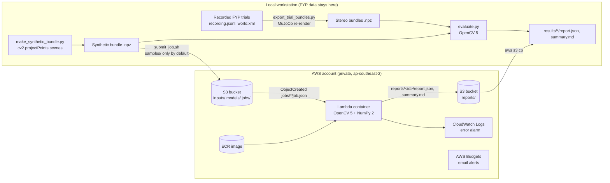

# AWS deployment: OpenCV 5 evaluation Lambda

> **Reproducing this in your own AWS account:** the stack name, the CLI profile
> `galbot-cv5` and the Region `ap-southeast-2` below are the author's. Use your own profile and
> Region (and change the Region in `deployer-policy.json`). No credentials or account IDs
> are in this repository. The status and cost notes describe the author's deployment.

**Status: deployed on 2026-10-22** as stack `galbot-cv5-eval` in the project's
selected Region `ap-southeast-2` (Free Plan), with the owner's approval. Both the
synthetic job and the OpenCV 5 model job have run on AWS. Results are under
[Cloud runs](#cloud-runs-2026-10-22). Every further deploy or upload still needs
the owner's approval.

## Architecture



| Resource | Configuration |
|---|---|
| S3 bucket `galbot-cv5-eval-<account>-<region>` | SSE-S3 encryption, all public access blocked, bucket-owner-enforced ownership, TLS-only policy, objects expire after 30 days (parameter) |
| Lambda `<stack>-evaluator` | Container image (x86_64), 3008 MB, 600 s timeout, 2 GB `/tmp`, trigger `jobs/*job.json` only, optional reserved concurrency |
| IAM role | `s3:GetObject` on `inputs/*`, `models/*`, `jobs/*`; `s3:PutObject` on `reports/*`; CloudWatch Logs. No list or delete permissions; writes can't re-trigger the function. |
| ECR repository `galbot-cv5-eval-evaluator` | Created once with the CLI, outside the stack: private, AES256, scan on push, immutable tags. When the function is created, Lambda adds a pull policy scoped to this account's functions. |
| CloudWatch | Log group with 14-day retention; alarm on any function error |
| AWS Budgets | Monthly cost budget (default USD 5), email at 50 / 80 / 100 % actual and 100 % forecast |

Budgets **alert**; they do not stop spending. The cost limits are structural:
- The function runs only when a `job.json` is written.
- A job may name at most 20 bundles, and each object is capped at 256 MB.
- Reserved concurrency can cap parallel runs.
- Objects expire automatically.

## Local verification already done

| Check | Command | Result (2026-10-22) |
|---|---|---|
| Unit and integration tests | `.venv-cv5/bin/python -m pytest` | all pass (see top-level README) |
| Template lint | `.venv-tools/bin/cfn-lint aws/template.yaml` | no findings (cfn-lint 1.58.0) |
| SAM validation | `sam validate --lint` | valid SAM template (aws-sam-cli 1.169.0) |
| SAM build | `sam build --build-dir ../build/sam` | succeeded (image built locally, no credentials) |
| Container run | `aws/local_smoke_test.sh --with-model` | synthetic job OK about 2.0 s; cv2.dnn job OK about 2.3 s (Lambda RIE, 2 CPUs, 3008 MB limit) |

The local smoke test runs the real Lambda image through the AWS Lambda
Runtime Interface Emulator, with a directory standing in for S3
(`GALBOT_LOCAL_BUCKET_DIR`). RIE timings are not Lambda timings, and RIE
reports the configured memory as "Max Memory Used", so it says nothing about
real memory use.

## What goes into the image

`aws/stage_context.sh` builds `build/lambda-context` containing only:
- `galbot_cv5/*.py` (competition code)
- the FYP's ROS-free `head_localisation.py` and `head_yaw.py`, copied unchanged
- `requirements-lambda.txt` (`opencv-python-headless==5.0.0.93`, `numpy==2.5.4`)

The base image is pinned by digest. That digest locks Amazon Linux 2023 release
`2023.12.20260914`, so the Dockerfile upgrades openssl, curl, rpm, pcre2 and
libxml2 from the pinned later release `2023.12.20261021`. This cleared all the
HIGH and MEDIUM ECR scan findings in the base image (12 HIGH, 20 MEDIUM, 5 LOW
down to 0 / 0 / 0, with one UNDEFINED krb5 advisory left). When AWS publishes a
newer base digest, update `FROM` and re-check whether the upgrade step is still
needed. **No model weights, datasets or recordings** are baked in. A dnn job reads an ONNX model from `models/` at run
time, so uploading the model is a separate, explicit step.

Note that pushing the image to ECR does upload that competition code and the
two FYP geometry files to your private registry. Include that in the
data-sharing decision.

## Deploy (only after approval)

Prerequisites:
- **Sign-in:** this project uses the new AWS experience (selected Region `ap-southeast-2`). Sign in
  with `aws login --region ap-southeast-2 --profile galbot-cv5`. That gives you short-lived
  credentials for the AWS-managed team-member role (`AccountFullAccessRole`); there are no IAM
  users or access keys. `deployer-policy.json` applies only to an account on the advanced experience.
- **Before deploying:** run `aws/preflight.sh galbot-cv5`, which is read-only. It shows the plan,
  remaining credits, Lambda limits, the bucket name and month-to-date cost.
- **Tools:** Docker, and the tools environment:
  `python3 -m venv .venv-tools && .venv-tools/bin/pip install -r aws/requirements-tools.txt`.

The stack is deployed with plain CloudFormation change sets, not `sam deploy`.
SAM CLI 1.169 won't create a change set without an S3 staging bucket
(`--resolve-s3` adds the extra `aws-sam-cli-managed-default` stack), and
`--resolve-image-repos` adds a companion stack. CloudFormation runs the
`AWS::Serverless` transform on the server, and the template fits inline
(under 51,200 bytes), so neither extra resource is needed. SAM is used only
for `sam build`.

```bash
cd vision2action      # the repository root
export SAM_CLI_TELEMETRY=0 AWS_PROFILE=galbot-cv5 AWS_REGION=ap-southeast-2
repo=$(aws sts get-caller-identity --query Account --output text).dkr.ecr.$AWS_REGION.amazonaws.com
tag=opencv5-$(git rev-parse --short HEAD)

# 1. Build and test the image locally (Lambda RIE, no AWS calls).
aws/local_smoke_test.sh --with-model

# 2. One-off: the private image repository (not part of the stack).
aws ecr create-repository --repository-name galbot-cv5-eval-evaluator \
    --image-tag-mutability IMMUTABLE --image-scanning-configuration scanOnPush=true \
    --encryption-configuration encryptionType=AES256

# 3. Push the tested image. The login token goes straight to docker and is removed afterwards.
aws ecr get-login-password | docker login --username AWS --password-stdin "$repo"
docker tag galbot-cv5-eval:local "$repo/galbot-cv5-eval-evaluator:$tag"
docker push "$repo/galbot-cv5-eval-evaluator:$tag"     # note the sha256 digest it prints
docker logout "$repo"
# Check the scan: aws ecr describe-image-scan-findings --repository-name galbot-cv5-eval-evaluator --image-id imageTag=$tag

# 4. Template pinned to that digest, then a change set that is NOT executed.
(cd aws && ../.venv-tools/bin/sam build --build-dir ../build/sam)
sed "s#ImageUri: evaluatorfunction:opencv5#ImageUri: $repo/galbot-cv5-eval-evaluator@sha256:<digest>#" \
    build/sam/template.yaml > build/deploy-template.yaml
aws cloudformation create-change-set --stack-name galbot-cv5-eval --change-set-name "initial-${tag#opencv5-}" \
    --change-set-type CREATE --template-body file://build/deploy-template.yaml \
    --capabilities CAPABILITY_IAM CAPABILITY_AUTO_EXPAND --tags Key=project,Value=galbot-cv5-eval \
    --parameters ParameterKey=BudgetEmail,ParameterValue=you@example.com ParameterKey=MonthlyBudgetUsd,ParameterValue=5
aws cloudformation describe-change-set --stack-name galbot-cv5-eval --change-set-name "initial-${tag#opencv5-}"
# Review: 8 resources (S3 bucket + policy, Lambda + S3 invoke permission, IAM role, log group, alarm, budget).

# 5. Only after the owner approves the reviewed change set:
aws cloudformation execute-change-set --stack-name galbot-cv5-eval --change-set-name "initial-${tag#opencv5-}"
aws cloudformation wait stack-create-complete --stack-name galbot-cv5-eval
```

For later image updates, push a new tag and create an `UPDATE` change set with
the new digest. With immutable tags, an old tag can't be overwritten. Delete
images the function no longer references.

**Verify the budget alert address after the first deploy.** Since AWS Budgets moved
email recipients to AWS User Notifications, a newly added address receives **no** alerts
until it is verified:
1. An email from an `@aws.com` sender arrives at the address. Choose its link within
   12 hours and sign in to this AWS project to complete verification.
2. Check the status in the console: Billing and Cost Management, then Budgets, then
   `galbot-cv5-eval-monthly`, where each recipient shows **Active**, **Pending** or
   **Inactive**. Use **Resend verification** for Pending, or **Send Notification** for
   Inactive.

The project's managed service control policy denies the User Notifications contacts
API, so the status can't be read from the CLI. The console is the only check.

## Run the synthetic smoke job in the cloud

```bash
cd vision2action      # the repository root
.venv-cv5/bin/python tools/make_synthetic_bundle.py       # samples/synthetic (no project data)
aws/submit_job.sh "$(aws cloudformation describe-stacks --stack-name galbot-cv5-eval \
    --query 'Stacks[0].Outputs[?OutputKey==`BucketName`].OutputValue' --output text)" samples/synthetic
# -> results/cloud/synthetic-smoke/report.json and summary.md
```

`submit_job.sh` uses the `AWS_PROFILE` and `AWS_REGION` exported above. It
refuses directories outside `samples/` unless `--allow-project-data`
is passed. Only use that flag for data the owner has cleared for upload, which
means the sanitised copies in `build/upload/` (`tools/sanitize_for_upload.py`).

A `dnn` job also needs the model in `models/`, but `submit_job.sh` uploads only
the bundles. Upload the sanitised ONNX yourself, and either put
`"input_shape": [480, 640]` in the job or upload the sanitised `.json` sidecar
next to the model:

```bash
aws s3 cp models/cube_yolo11n_seg.onnx "s3://$bucket/models/cube_yolo11n_seg.onnx"
# job.json: {"job_id": "fyp-headless-sweep-dnn", "bundles": ["headless_sweep.npz"],
#            "mask_sources": ["dnn", "gt", "hsv"], "model": "cube_yolo11n_seg.onnx", "input_shape": [480, 640]}
aws/submit_job.sh "$bucket" build/cloud-jobs/fyp-headless-sweep --allow-project-data
```

`submit_job.sh` downloads as soon as the first report file appears, and a job ID
that already has a report returns at once. Use a new job ID for each run, and
re-copy `reports/<id>/` if `summary.md` is missing.

## Cloud runs (2026-10-22)

Measured on the deployed stack (image `opencv5-6af372c`, OpenCV 5.0.0, NumPy 2.5.4,
Python 3.12.15, 3008 MB, 2 OpenCV threads). Reports are in `results/cloud/<job>/`.

| Job | Lambda duration (billed) | Max memory | Accuracy vs local baseline |
|---|---|---|---|
| `synthetic-smoke` (hsv, gt; 12 samples) | 8.4 s (11.6 s, including a 3.3 s cold start) | 190 MB | identical tables; 10 of 736 values differ, by about 1e-17 (floating-point rounding) |
| `fyp-headless-sweep-dnn` (dnn, gt, hsv; 21 samples) | 19.7 s (19.7 s) | 298 MB | identical tables; largest difference 1.2e-13 (floating-point rounding) |
| `live-20261022_173928` (live mission: dnn, gt, hsv on 3 samples + `live_missions`; image `opencv5-4427a3f`) | 9.6 s (14.6 s, including a 5.0 s cold start after the image update) | 245 MB | identical accuracy tables and live-mission section |
| `live-20261022_180808` (same, second live mission) | 3.5 s (4.1 s, including a 0.6 s cold start) | 245 MB | identical accuracy tables and live-mission section |

Accuracy reproduces exactly. Timings don't: on Lambda, `cv2.dnn` segmentation
has a median of 242 ms (one 1.4 s cold sample) against 49 ms locally with 8 threads, and pose fitting
takes about 173 ms against 65 ms. That reflects about 2 vCPUs at 3008 MB, so use
local numbers for latency claims. Recorded-mission replay (`recorded_trials`)
stays local by design, so cloud reports have no "Live FYP perception" section. Live
runs instead upload `live_missions.json` (poses, outcome and detector statistics only;
`tools/export_live_missions.py`), which the Lambda scores into a "Live missions" section.


## Expected cost (approximate; check current pricing for your region)

- **Lambda:** measured jobs bill 12 to 20 s at 2.94 GB, about 35 to 58 GB-seconds. At the
  published x86 rate of roughly USD 0.0000167 per GB-second, that is a fraction of
  a cent per job. Requests are free under 1 M per month.
- **ECR:** the pushed image is 281 MB compressed. At about USD 0.10 per GB-month,
  that's about USD 0.03 per month. Delete old images.
- **S3, CloudWatch Logs:** megabytes of data, so negligible. Lifecycle and retention
  rules expire them.
- **AWS Budgets:** the first budgets in an account are free of charge.

These are estimates from public list prices. Cost Explorer showed USD 0.00 month to date
after both cloud runs on 2026-10-22, and the Free Plan was still active.

## Tear down (only after judging, with the owner's approval)

The resources are being kept for judging. Deleting them can't be undone: the reports,
the uploaded bundles, the model and the image are removed. Copy anything you need first
(`results/cloud/` already holds the reports).

```bash
export AWS_PROFILE=galbot-cv5 AWS_REGION=ap-southeast-2
bucket=$(aws cloudformation describe-stacks --stack-name galbot-cv5-eval \
    --query 'Stacks[0].Outputs[?OutputKey==`BucketName`].OutputValue' --output text)

# 1. Look first: what will be deleted.
aws cloudformation list-stack-resources --stack-name galbot-cv5-eval \
    --query 'StackResourceSummaries[].[ResourceType,PhysicalResourceId]' --output table
aws s3 ls --recursive "s3://$bucket" | wc -l
aws ecr describe-images --repository-name galbot-cv5-eval-evaluator --query 'imageDetails[].imageTags'

# 2. Empty the bucket (CloudFormation can't delete a non-empty bucket). It is unversioned.
aws s3 rm "s3://$bucket" --recursive

# 3. Delete the stack: bucket, bucket policy, Lambda, S3 invoke permission, IAM role,
#    log group (and its logs), error alarm and budget.
aws cloudformation delete-stack --stack-name galbot-cv5-eval
aws cloudformation wait stack-delete-complete --stack-name galbot-cv5-eval

# 4. Delete the image repository, which is not part of the stack. --force also deletes its images.
aws ecr delete-repository --repository-name galbot-cv5-eval-evaluator --force

# 5. Verify nothing is left.
aws cloudformation describe-stacks --stack-name galbot-cv5-eval 2>&1 | grep -q 'does not exist' && echo "stack gone"
aws s3api head-bucket --bucket "$bucket" 2>&1 | grep -qE '404|Not Found' && echo "bucket gone"
aws ecr describe-repositories --repository-names galbot-cv5-eval-evaluator 2>&1 | grep -q RepositoryNotFound && echo "repository gone"
aws logs describe-log-groups --log-group-name-prefix /aws/lambda/galbot-cv5-eval --query 'logGroups[].logGroupName'
aws budgets describe-budgets --account-id "$(aws sts get-caller-identity --query Account --output text)" \
    --query 'Budgets[].BudgetName'
```

If `delete-stack` ends in `DELETE_FAILED`, it's almost always the bucket. Check
`aws cloudformation describe-stack-events --stack-name galbot-cv5-eval`, empty the bucket
again, and repeat step 3.

Afterwards, check Cost Explorer (AWS Billing and Cost Management) a day later for any
remaining charges. The budget's alert address and its verification in AWS User
Notifications stay in the project; they cost nothing. Removing the local
`build/upload/` copies and `results/cloud/` is a separate, local decision.
