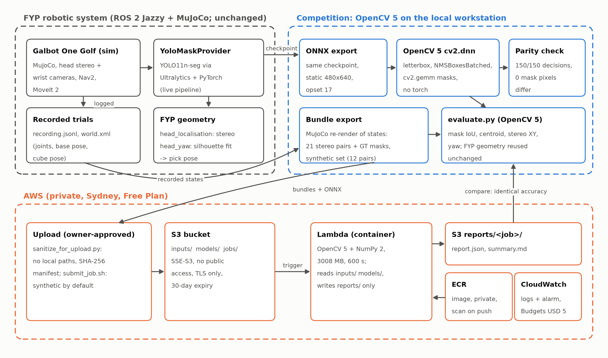
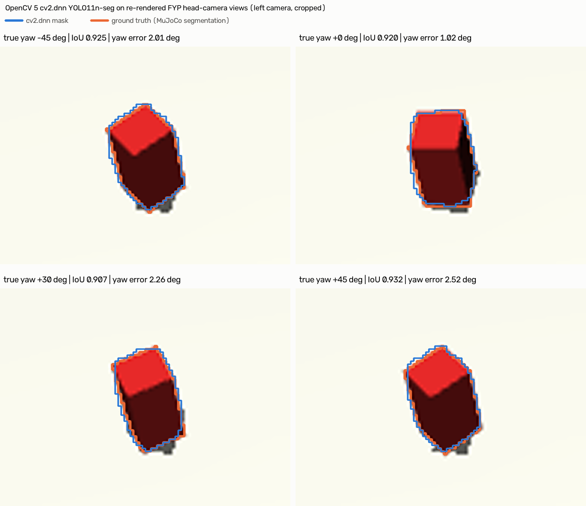
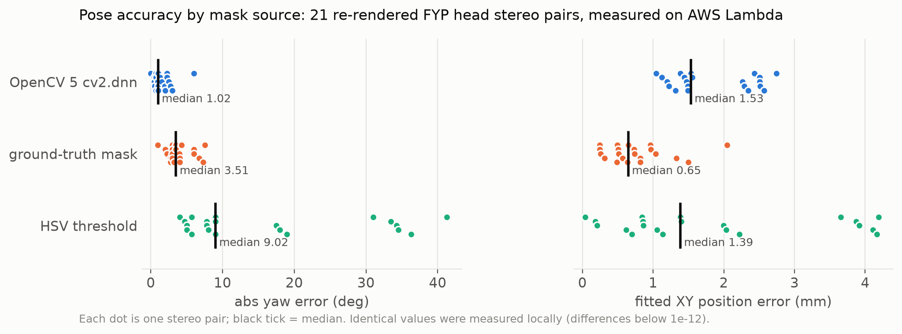
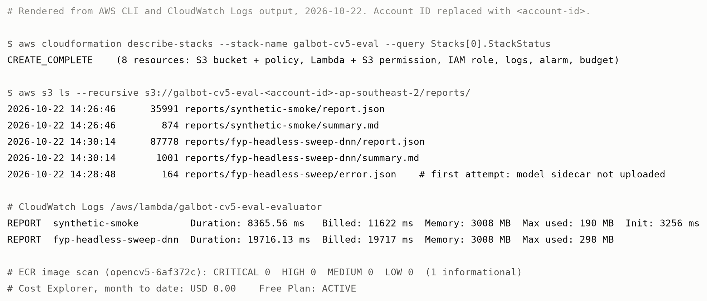
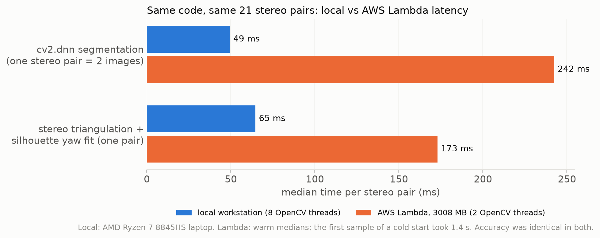

# Vision2Action: reproducible OpenCV 5 perception evaluation for a mobile manipulator

Technical report, OpenCV AI Competition 2026. All numbers were measured on 2026-10-22
and come from the committed reports in `results/`. Figures are in
`docs/figures/`.

## Summary

Vision2Action takes the perception stage of an existing ROS 2 mobile manipulation
system (a Galbot One Golf humanoid in MuJoCo, built as a final-year project) and makes it
**portable, checkable and reproducible with OpenCV 5**:

1. **OpenCV 5 inference.** The project's YOLO11n-seg cube detector runs in OpenCV 5
   `cv2.dnn`, with no PyTorch or Ultralytics. On 150 validation images it gives the
   **same detection decisions (150/150) and identical masks (0 differing pixels)** as
   the original Ultralytics pipeline, and it is faster on the same CPU: 20.9 ms against
   25.3 ms median end to end.
2. **A perception evaluation framework.** Built on OpenCV 5 and the robot's own geometry
   code. It scores segmentation, stereo position and yaw against simulator ground truth
   on re-rendered robot trials, recorded missions and a synthetic set.
3. **A reproducible cloud evaluation.** The same evaluation runs as a container-image AWS
   Lambda (S3 → Lambda → S3) in a private, Free Plan project. Accuracy on AWS is
   **identical to the local run**, with differences below 1e-12. Latency differs and is
   reported separately.

The robot's own ROS 2 code (navigation, manipulation, mission and recovery) was not modified.

## 1. System context

The robot runs ROS 2 Jazzy with Nav2 and MoveIt 2 on a MuJoCo model of the Galbot One
Golf. It drives to a table, finds a 30×30×60 mm red block and picks it with one arm.
The perception pipeline it uses for the pick:
- a fine-tuned YOLO11n-seg model segments the block in the head stereo cameras
  (`YoloMaskProvider`, Ultralytics on PyTorch)
- `head_localisation` triangulates the mask centroids into a 3D point
- `head_yaw` fits the block's yaw with a coarse-to-fine silhouette IoU search over a box model

Each mission is recorded (joints, base pose, block pose, mission events) to
`recording.jsonl`. The recordings hold no images.

The competition code lives in this repository. It reuses the FYP's
`head_localisation.py` and `head_yaw.py` unchanged (copies in `fyp/`), and it never
writes to the robot packages or their Python environment. The robot-side OpenCV 5
backend is in `integration/ros2/`.

## 2. Stage 1: the detector in OpenCV 5

**Pipeline** (`galbot_cv5/yolo_seg_dnn.py`):
1. Ultralytics-compatible letterbox (`cv2.resize`, `cv2.copyMakeBorder`) and
   `cv2.dnn.blobFromImage`.
2. `cv2.dnn.readNetFromONNX(..., engine=ENGINE_NEW)`.
3. Decoding with class-aware `cv2.dnn.NMSBoxesBatched`.
4. Mask assembly with `cv2.gemm` and `cv2.resize`.
5. Selection of the highest-scoring block, as the robot's adapter does.

**Two findings mattered:**
- **Input size.** Ultralytics runs `.pt` checkpoints with `rect=True`, so 640×480
  images reach the network unpadded at 480×640. A square 640×640 export changed scores
  by up to 0.059. Exporting at 480×640 made the outputs identical, with raw score
  differences ≤ 1.3e-6.
- **Thread contention.** NumPy's `@` woke a 16-thread OpenBLAS pool that slowed the next
  `cv2.dnn` forward pass from about 20 ms to about 70 ms. `cv2.gemm` keeps the work in
  OpenCV's own thread pool.

**Parity and speed.** 150 MuJoCo validation images (60 head, 90 wrist; 140 with the
block, 10 empty), confidence 0.35, 8 threads, AMD Ryzen 7 8845HS laptop:

| | Ultralytics (robot adapter) | OpenCV 5 `ENGINE_NEW` | OpenCV 5 `ENGINE_CLASSIC` |
|---|---|---|---|
| Detection decisions matching Ultralytics | — | 150 / 150 | 150 / 150 |
| Mask pixels differing (max per image) | — | **0** | **0** |
| Recall / false positives on empty images | 140/140, 0/10 | 140/140, 0/10 | 140/140, 0/10 |
| Mask IoU vs ground truth (median) | 0.9266 | 0.9266 | 0.9266 |
| End-to-end latency, median (p95) | 25.3 (30.4) ms | **20.9 (24.8) ms** | 51.4 (65.6) ms |

Network forward pass only, same tensor, 8 threads: PyTorch 27.0 ms, OpenCV 5 NEW
19.6 ms, CLASSIC 45.5 ms (`results/latency_forward_sweep.jsonl`).

## 3. Stage 2: the evaluation framework

**For each head stereo pair:**
1. Get a mask from one of three sources:
   - `dnn`: OpenCV 5, as above.
   - `hsv`: a model-free red threshold.
   - `gt`: MuJoCo segmentation, as an oracle.
2. Run the robot's own `mask_centroid`, `triangulate` and `fit_head_yaw`.
3. Compare with the true block pose. Yaw is compared modulo 90°, because the square
   footprint only defines yaw up to a quarter turn.

**Inputs:**
- **Re-rendered robot trials:** 7 trials of the head-yaw sweep (block yaw 0, ±15, ±30,
  ±45°), 3 samples each, giving 21 stereo pairs. They are rendered from the recorded
  joints and poses, with ground-truth masks from MuJoCo segmentation.
- **Recorded missions:** 11 missions, scored on the first pose the pick actually used.
  This is log analysis only.
- **Synthetic:** 12 stereo pairs drawn with `cv2.projectPoints`. They contain no project data.

**Results on the 21 re-rendered pairs** (median / p95 / max; identical locally and on AWS):

| Mask source | Pose found | Mask IoU | Stereo XY error (mm) | Fitted XY error (mm) | Yaw error (deg) |
|---|---|---|---|---|---|
| OpenCV 5 dnn | 21/21 | 0.923 / 0.934 / 0.936 | 1.53 / 2.97 / 4.87 | 1.53 / 2.57 / 2.74 | **1.02 / 2.98 / 6.02** |
| ground-truth mask | 21/21 | 1.000 | 0.66 / 1.33 / 1.36 | 0.65 / 1.50 / 2.05 | 3.51 / 7.27 / 7.52 |
| HSV threshold | 21/21 | 0.893 / 0.969 / 0.971 | 6.81 / 10.46 / 10.90 | 1.39 / 4.16 / 4.19 | 9.02 / 36.27 / 41.27 |

**Recorded missions (11):**
- live XY error 1.62 / 2.49 / 2.99 mm
- yaw error 2.01 / 3.89 / 4.02°
- 10 of 11 missions succeeded; the failure was the +15° headless trial

**Synthetic (12 pairs):** with ground-truth masks, yaw error is 0.31 / 0.79 / 0.84°.
With HSV masks, IoU is 0.984 and yaw error is 0.81 / 2.05 / 2.12°.

**Observations:**
- **Ground-truth masks give worse yaw than the DNN masks.** MuJoCo's geom segmentation is
  slightly smaller than the box-model silhouette (IoU about 0.90 at the true pose). On
  synthetic data, where mask and model agree exactly, ground-truth masks recover yaw
  within 0.84°.
- **HSV is a weak baseline.** It wasn't tuned to the simulator's lighting, and its yaw
  tail reaches 41°. That's why the robot moved to learned segmentation.

## 4. Reproducible evaluation on AWS

**Deployment:** one CloudFormation stack in a private AWS project (Sydney Region, Free Plan):
- a private S3 bucket: encrypted, public access blocked, HTTPS only, objects expire after 30 days
- a container-image Lambda: OpenCV 5.0.0, NumPy 2.5.4, x86_64, 3008 MB, 600 s timeout
- an execution role that can only read `inputs/`, `models/` and `jobs/` and write
  `reports/`, so a report can never re-trigger the function
- a 14-day log group, an error alarm, and a USD 5 monthly budget with email alerts

**Trigger:** writing `jobs/<id>/job.json` runs the evaluation, and the reports appear
under `reports/<id>/`.

**Image:** pinned by digest, built from a pinned base image. Five base-image libraries
(openssl, curl, rpm, pcre2 and libxml2; nine packages) are upgraded from a pinned
later Amazon Linux release. The ECR scan went from 12 HIGH and
20 MEDIUM findings to none.

**Data hygiene before upload:**
- `tools/sanitize_for_upload.py` removes local paths from the bundle metadata and the
  ONNX `description`
- it checks that the pixel data and weights are unchanged, and writes a SHA-256 manifest
- `aws/submit_job.sh` uploads only synthetic data unless project data is explicitly allowed

**Cloud runs:**

| Job | Data | Lambda duration (billed) | Peak memory | Accuracy vs local |
|---|---|---|---|---|
| `synthetic-smoke` | 12 synthetic pairs, hsv + gt | 8.4 s (11.6 s, including a 3.3 s cold start) | 190 MB | identical (10 of 736 values differ by about 1e-17) |
| `fyp-headless-sweep-dnn` | 21 robot pairs, dnn + gt + hsv | 19.7 s (19.7 s) | 298 MB | identical (largest difference 1.2e-13) |

## 5. Latency: local and AWS are different measurements

Accuracy carries over exactly; latency does not. The rows below are not interchangeable.

| Measurement | Where | CPU / threads | Scope | Median (p95) |
|---|---|---|---|---|
| OpenCV 5 forward pass only | local | Ryzen 7 8845HS, 8 threads | one 480×640 tensor | 19.6 ms |
| OpenCV 5 end to end | local | same, 8 threads | one image: letterbox to selected mask | **20.9 (24.8) ms** |
| Ultralytics end to end | local | same, 8 threads | one image (robot adapter) | 25.3 (30.4) ms |
| cv2.dnn segmentation in the evaluation | local | same, 8 threads | one stereo pair (2 images) | 49.4 (55.4) ms |
| cv2.dnn segmentation in the evaluation | **AWS Lambda** | 3008 MB, 2 OpenCV threads | one stereo pair (2 images) | **242.4 (246.1) ms**; first sample after a cold start: 1425 ms |
| triangulation + silhouette yaw fit | local | 8 threads | one stereo pair | 64.6 (66.7) ms |
| triangulation + silhouette yaw fit | **AWS Lambda** | 2 threads | one stereo pair | 173.0 (174.1) ms |
| whole 21-pair job | **AWS Lambda** | 3008 MB | download, evaluate, write reports | 19.7 s |

Lambda gives this function about 2 vCPUs at 3008 MB, against 8 threads on the laptop,
so it is about 5× slower for the DNN and about 2.7× slower for the geometry. The cloud is
here for **reproducible, isolated, auditable evaluation**, not for real-time inference.
Real-time numbers come from the local measurements.

## 6. Security, cost and operations

- **Scope:** no public endpoints (no function URL, no API), no IAM users and no access
  keys. Deployment used short-lived `aws login` credentials.
- **Data:** only data the owner approved was uploaded: the synthetic bundle, the
  sanitised 21-pair bundle and the sanitised ONNX model. Recordings stay local.
- **Cost:** USD 0.00 month to date in Cost Explorer after both runs, and the project is
  still on the Free Plan. Estimated running cost is about USD 0.03 per month (281 MB in
  ECR), with Lambda use far inside the free allowance.
- **Teardown:** documented in `aws/README.md`. The resources are being kept until judging ends.

## 7. Limitations

- **Simulation only.** All images are MuJoCo renders from the same generator as the
  training set. Nothing here measures real-camera accuracy, and the model is
  simulation-specific.
- **Small stereo set.** There are 21 re-rendered pairs from 7 trials of one yaw sweep,
  11 recorded missions and 12 synthetic pairs. The p95 and max values rest on a few
  samples, and there are no confidence intervals.
- **Re-rendered, not recorded, frames.** The robot logs store no images, so stage 2
  scores re-rendered views of the recorded states. Lighting and timing match only
  approximately.
- **Parity, not improvement.** OpenCV 5 reproduces the detector exactly. It removes
  PyTorch from the inference path and is faster locally, but it is no more accurate.
- **Model deployment.** The ONNX graph is static at 480×640. Other sizes are
  letterboxed, which matches Ultralytics' ONNX behaviour but not its `.pt` behaviour.
  The robot itself still runs the Ultralytics adapter. Swapping in the OpenCV 5 runner
  on the robot is possible, but it was not done or validated.
- **Cloud latency.** It is not representative of on-robot latency, as above.
- **The error alarm doesn't fire for failed jobs.** The handler catches job errors and
  writes `reports/<id>/error.json`, so Lambda counts the invocation as a success.
  `aws/submit_job.sh` exits with an error and prints `error.json` in that case. Making
  the alarm fire would need a template change, which was deferred.
- **Licence.** The weights derive from Ultralytics YOLO11 (AGPL-3.0).

## 8. Reproduce

The full commands are in `README.md` (environments, benchmark, evaluation, tests)
and `aws/README.md` (image, change set, jobs). The
figures are regenerated by `tools/figure_overlays.py` (`.venv-cv5`) and
`tools/figure_charts.py` (`.venv-export`).
